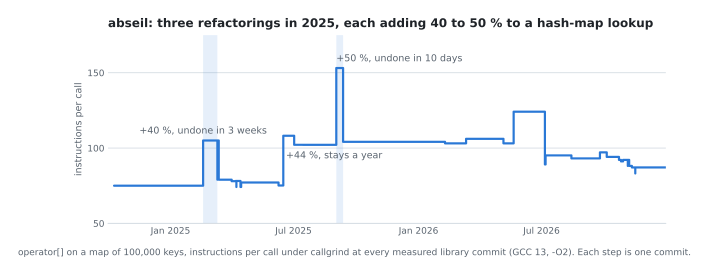

# hotpath-cost

**An analysis tool that finds performance problems in C++ hot paths by comparing the code with
itself: with its own past, commit by commit, before and after a pull request, and also under another
compiler and against the paths it could take.**

Whether a hot path (adding an order, logging a message, parsing a quote, pushing to a queue) is fast
*enough* is hard to say. Whether it *changed* can be said exactly: the tool counts the allocations,
locks and instructions of one call, which are the same on every run, so it can replay a library's
whole history, find every commit that changed them, name the line, and check an open pull request the
same way before it is merged. A long-maintained project with a rich history is where this pays off
most: the project is its own baseline, every cost it carries came in through some commit, and that
commit's message says what it was for.

Two other comparisons find what history cannot: the same code under GCC and clang, or `-O2` and
`-O3` (why one build is faster), and a static analysis of what the code *may* do against what the
tests actually run (paths nobody exercises). It works on existing code, unmodified.



Each step is one commit, found and named by replaying the library's history: costs come in through
ordinary refactorings; some leave within days and some stay for a year. Drawn from the tool's results by [`docs/figures/history.py`](docs/figures/history.py).

## Problems it found in real projects

Applied to 42 open-source C++ libraries used in trading, messaging and numerics (27,997 library
commits replayed, 148 open pull requests checked). What we reported upstream, with a fix where one
was ours to write:

### Accepted upstream

| library | what the tool found | found by | our change |
|---|---|---|---|
| [MPMCQueue](https://github.com/rigtorp/MPMCQueue) (lock-free queue) | **1.7x slower with GCC than with clang**: a 64-bit division by the capacity, done twice per operation | the compiler matrix, then machine-code facts | [issue #57](https://github.com/rigtorp/MPMCQueue/issues/57) and a four-line fix, merged by the author ([PR #58](https://github.com/rigtorp/MPMCQueue/pull/58)): 52.5 -> 29.6 ns with GCC, faster with clang too |

### Reported upstream, under review

| library | what the tool found | found by | our report |
|---|---|---|---|
| [Liquibook](https://github.com/enewhuis/liquibook) (order book) | **An out-of-bounds write.** `Depth::find_level` returns a past-the-end pointer instead of `nullptr`, so fills of a triggered stop order overwrite the book's members; in ordinary order flow | a random order flow aimed at the paths the static analysis listed, which surfaced an unexpected exception | [issue #44](https://github.com/enewhuis/liquibook/issues/44); fix with regression tests in [PR #45](https://github.com/enewhuis/liquibook/pull/45) |
| [msgpack-c](https://github.com/msgpack/msgpack-c) (MessagePack) | **2 heap allocations per message** when unpacking into a reused zone, the documented way to avoid them; since the visitor API of 2016 | exact counts, then the allocating stacks | [issue #1222](https://github.com/msgpack/msgpack-c/issues/1222); fix in [PR #1223](https://github.com/msgpack/msgpack-c/pull/1223), CI green: 0 allocations, 118.6 -> 83.7 ns |
| [hffix](https://github.com/jamesdbrock/hffix) (FIX protocol) | **The same encoder 2.8x apart** between compilers and levels: an integer-to-ASCII helper left out of line converts constant tags at run time | the compiler matrix, then machine-code facts | [issue #63](https://github.com/jamesdbrock/hffix/issues/63); fix in [PR #64](https://github.com/jamesdbrock/hffix/pull/64) |
| [Eigen](https://gitlab.com/libeigen/eigen) (linear algebra) | **Eigen 5's 4x4 Cholesky solve 1.48x slower than 3.4** with GCC; the step is one commit of April 2025 | instructions per call across the history, then timing | the bisection and timings, added to the maintainers' open [issue #3206](https://gitlab.com/libeigen/eigen/-/issues/3206) |
| [parallel-hashmap](https://github.com/greg7mdp/parallel-hashmap) (hash map) | **An open "AVX2 optimization" that is slower** in every case measured, up to 42 % for missing keys in a large table | checking every open pull request, then a standalone benchmark | the benchmark, posted on [PR #167](https://github.com/greg7mdp/parallel-hashmap/pull/167#issuecomment-6961404564), whose open question was whether it helps |

The issues, pull requests and comments above were written and submitted by us (GitHub
[akamoyoo](https://github.com/akamoyoo)), each with the numbers behind it; their state is as of
November 17, 2026.

### Found in the history, already fixed upstream or by design

| library | what the tool found | found by |
|---|---|---|
| [Liquibook](https://github.com/enewhuis/liquibook) | **Its last release allocates twice as often per order** (1 -> 4 per add+cancel, 433 against 383 ns); fixed the next day in a commit no release contains, and there has been no release since 2017 | the history replay |
| [spdlog](https://github.com/gabime/spdlog) (logger) | **A mutex lock per message** on the null sink came back in a 2018 refactoring for six releases; **an allocation and a TLS destructor on every thread's first message** for eight releases (2024-2026); both since fixed by the maintainers | the history replay, bisected to single commits |
| [abseil](https://github.com/abseil/abseil-cpp) (`flat_hash_map`) | **Refactorings that cost and fixes that follow:** one made `operator[]` 50 % more instructions and 37 % slower, undone by the maintainers ten days later; insert+erase is 13 to 16 % slower than in 2018 | instructions per call across the history, then timing |
| [Boost.Unordered](https://github.com/boostorg/unordered) (`unordered_map`) | **Two 64-bit divisions per lookup for integer keys for eight years**: the policy meant for them (a prime number of buckets) took effect through a 2014 typedef fix and made lookups 13 to 26 % slower and insert+erase 36 % slower in this workload; removed in 2022 after a benchmark report (#50). Since 2008: 37 % more instructions per lookup, and 26 % faster | instructions per call across 18 years, then timing and division counts |
| [concurrentqueue](https://github.com/cameron314/concurrentqueue) | **A malloc and a free per 32 elements** whenever the queue's length crosses its initial capacity, since 2022; deliberate, documented, switched off by a trait, and close to free on one thread | a random enqueue/dequeue flow aimed at the sites the static analysis listed |

Details and how each was found: [docs/cases.md](docs/cases.md). All libraries, including the quiet
ones and the other open pull requests: [docs/results.md](docs/results.md).

## Why history

- **Costs come in through ordinary commits, and stay.** A refactoring put a mutex lock back on spdlog's
  null sink for six releases; a simplification made Liquibook's last release allocate four times per
  order instead of one; one abseil refactoring made `operator[]` 37 % slower until a fix ten days
  later; msgpack-c's extra allocation per message has been there since 2016. Each passed review and
  tests. Each is one line in the replay, at the commit that made it.
- **Exact counts make every commit comparable.** Timing every commit does not work: two builds with
  identical machine code measured 2x apart. Counts do not move between runs, so a single extra
  allocation is visible among 1,856 commits, and bisection is sound.
- **The richer the history, the more there is to find.** Over 42 libraries, the replay found 20
  count changes in Taskflow's 1,069 commits, 11 in nlohmann/json's 822 and 24 instruction changes in
  abseil's 1,197; in SPSCQueue's 22 commits, nothing.
- **The same comparison runs forward.** `check.py` compares a pull request with its merge base, and
  `prs.py` does it for every open pull request: 148 of them, in 14 libraries.
- **Its limit is how far back the workload compiles.** When a library's API changes, old commits do
  not build with today's workload: 97 of msgpack-c's 290 library commits, 54 of hffix's 69. A change
  across such a gap is reported as an interval, not a commit.

## How it works

Two views of the same code, matched site by site:

- **Static** ([`static/`](static/README.md), `fn-effects`, an LLVM 21 pass): for every function of the
  program, whether it may or always allocates, locks, enters the kernel or throws, through everything
  it calls, with the call chain and the evidence each answer rests on. No annotations.
- **Run time** (`replay/`): a small workload per library calls its hot operations through out-of-line
  entry functions. The tool builds it at any commit and counts allocations, frees and mutex locks per
  call exactly (or instructions per call, under callgrind), records the stack of each, and replays the
  library's history to find and bisect every change.

`combine.py` puts the two side by side: what the workload exercised, what the static analysis says is
reachable but the workload never reached, and anything seen at run time that the analysis missed
(none, on Liquibook and concurrentqueue, where the two were matched). Because throwing a C++ exception
allocates (`__cxa_allocate_exception`), the counts also reveal exceptions thrown inside a library,
including those the library catches itself and nobody sees; the reports mark them. Liquibook's order book, release 2.0.0's code against the fix:

```
$ replay/combine.py liquibook 25b0c5ec
== hp_entry::lb_add(...)
   reached 4 of the 19 static sites not marked cold
   exercised (5):
      alloc src/book/order_book.h:654   OrderBook::add_order      per call 0.50   (line)
      alloc src/book/order_book.h:665   OrderBook::add_order      per call 0.50   (line)
      alloc src/book/depth.h:418        Depth<5>::find_level      per call 0.50   (library)
      alloc src/book/depth.h:433        Depth<5>::find_level      per call 0.50   (library)
      alloc src/book/order_book.h:1049  OrderBook::callback_now   per call 1.00   (line)
   static miss (0)

$ replay/combine.py liquibook dd5ada83          # the fix
   exercised (4): the same, without callback_now
```

Both versions *may* allocate in `callback_now`; only the run-time count tells them apart. The sites the
workload never reaches (stop orders, all-or-none matching) are where the random order flow went next,
and where it found the out-of-bounds write.

## Use

```
./fetch.sh                                     # clone the libraries into src/
replay/check.py LIB BASE HEAD                  # a change under review: counts, changed stacks, instructions
replay/prs.py LIB                              # the same for every open pull request (needs gh)
replay/replay.py LIB [--metric instr]          # counts (or instructions) at every library commit
replay/diff.py LIB [--instr 5]                 # which commits changed them
replay/explain.py LIB COMMIT                   # which stacks that commit added, removed or changed
replay/combine.py LIB COMMIT                   # static and run time side by side (needs static/ built)
replay/price.py LIB A B                        # what a change costs in time, alternating on one core
replay/gap.py LIB ENTRY                        # why one compiler or level is faster
replay/selftest.py                             # check the tool against results it is known to give
```

To add a library, write a workload (and, for the static view, a driver): see
[docs/method.md](docs/method.md#using-it-on-another-library). [AGENTS.md](AGENTS.md) is written for a
coding agent running the tool: every command, how to read its output, the known pitfalls.

## What we learned building it

Each of these changed how the tool works ([evidence](docs/insights.md)):

1. **Timing every commit does not work; counting does.** Two builds with the same machine code
   measured 2x apart, just because other work was running on the machine. The number of allocations,
   locks and instructions in one call is the same on every run. So the tool finds changes by counting,
   and times only the commits where a count changed, alternating the two builds on an idle core.
2. **More instructions usually means slower, but not always, and never by a predictable amount.**
   Usually time moved the same way as the instruction count, by anything from a tenth of it to twice
   it. But a Boost.Unordered change that replaced two 64-bit divisions per lookup with a few
   multiplications added 45 % instructions and made lookups up to 21 % faster. An instruction change
   is a reason to time, not a verdict.
3. **Different machine code, or even an extra allocation, may cost nothing.** Compiler hints that
   visibly changed a queue's machine code made no measurable difference. A malloc and a free for
   every 32 elements cost concurrentqueue 0.5 % on one thread. Only a measurement says it costs.
4. **When one compiler is much slower, the cause is usually one of a few things**: a small helper
   that one compiler did not inline, a division computed twice, or a loop vectorised by only one
   compiler. The fix goes in the library's source, and has to be checked with every compiler, since a
   fix for one can slow another.
5. **Static analysis and run-time counts find different things, and work best together.** Only the
   counts could tell two Liquibook versions apart; only the static analysis showed the 80 allocating
   paths that the test workload never ran. A random order flow sent down those paths reached 14 of the
   85 instead of 5, and one of the "allocations" it counted was an exception the order book threw and
   swallowed in ordinary trading. Following that exception led to the out-of-bounds write. A tool
   built to count allocations found a memory-corruption bug, because the static view said where to
   look and an exception is an allocation.

## Repository

- `static/`: the static analyser, its rules, evidence levels and 1,180 tests ([README](static/README.md)).
- `replay/`: the run-time tools above; `replay/workloads/` holds one workload per library,
  `replay/drivers/` the entry functions the static view analyses.
- `cases/`: scripts and outputs that reproduce the compiler cases (hffix, MPMCQueue, atomic_queue,
  Eigen) and the attributions of Liquibook and spdlog.
- `results/`: per-commit measurements behind every table (`results/gcc/`, `results/gcc-instr/`), and
  the compiler matrix (`results/matrix/`).
- `docs/`: [cases](docs/cases.md), [all libraries](docs/results.md), [lessons](docs/insights.md),
  [method, what did not work and how to reproduce](docs/method.md).

## Limits

- Counts cover the paths the workloads take; the static half covers the rest, and can only say "may".
- Only the malloc family and `pthread_mutex_lock` are counted (`replay/counts.h`).
- Instruction counts of workloads with a second thread vary between runs; they are compared as ranges.
- Timings come from one machine (Haswell, Ubuntu 24.04) and are compared only within one table.

Research quality, Linux x86-64, LLVM 21 for the static half. An independent project, not affiliated with
the LLVM project. Apache-2.0; the libraries are fetched from their own repositories and are not part of
this one.
